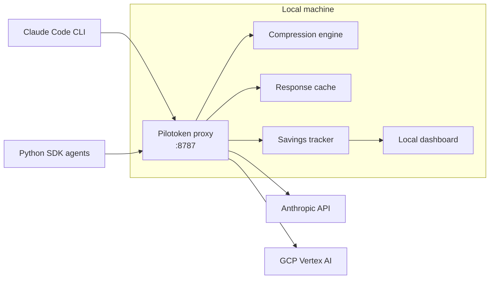

# Pilotoken — Local LLM Cost Proxy

> Cut LLM API costs for developer tools and AI agents — locally, with no code change.

**Personal project** · Showcase repository (no source code)

---

## The problem

Teams running Claude Code or Python agent pipelines send a lot of redundant tokens: repeated context, long tool outputs, re-sent files. Cloud-based optimizers fix part of this, but they require routing your prompts and code through a third-party server.

## The approach

Pilotoken is a **local proxy** that sits between your AI tools and the LLM provider. It compresses and caches requests **on your machine**, then forwards them to the provider you already use.

- **No code change**: tools and agents are redirected with one environment variable (`ANTHROPIC_BASE_URL`).
- **100% local**: prompts and code never leave the machine. Only license validation and price-table updates use a brief, explicit connection.
- **Pass-through**: same provider, same models, same authentication.

## Architecture

## Results (measured in real use)

| Metric | Value |
| --- | --- |
| Average token reduction | ~9% |
| Best-case reduction on a request | 15.9% |
| Cache hit rate | 89.5% |
| Tokens saved (lifetime, own usage) | 285,900 |

Measured on my own Claude Code usage. Compression gains depend heavily on workload: long tool outputs, logs and repeated context benefit most.

### Expected range for automated agent workloads (not yet verified)

Automated agent pipelines send far more tool outputs, logs and retrieved documents than interactive coding sessions, which is where compression has the most to work on. The upstream engine's own published benchmarks report:

| Benchmark (Headroom) | Compression | Accuracy kept |
| --- | --- | --- |
| Tool calling (BFCL) | 32% | 97% |
| Question answering (SQuAD v2) | 19% | 97% |

On that basis, a **~20–30% input-token reduction** is a reasonable expectation for agent workloads. This is **not yet measured with Pilotoken** — a benchmark on an automated agent pipeline is the next step.

Cost savings shown in the dashboard are **estimates** based on public provider pricing, not guaranteed amounts.

## Features

- Transparent interception of Claude Code CLI (including Claude Pro authentication) and Python SDK agents
- Token compression and response caching
- Routing to the Anthropic API or Google Cloud Vertex AI
- Local dashboard: tokens saved, cache hits, estimated cost avoided
- Windows installer (PyInstaller + installer packaging)
- Usage-based billing integration (Stripe, Supabase)

## Stack

Python · C# · TypeScript (web app and site) · Supabase · Stripe · PyInstaller

## Scope and limitations

- Works with tools that call the API and accept a custom base URL. Browser chat interfaces (ChatGPT web, Claude.ai web) are not supported by design.
- Windows first. Docker / Linux support is on the roadmap.

## Credits

The compression engine builds on the open-source [Headroom](https://github.com/headroomlabs-ai/headroom) project (Apache 2.0).

## Screenshots

_Add dashboard screenshots here (tokens saved, cache hit rate, cost avoided)._

---

**Author:** Steve Simon — Senior AI Engineer · [LinkedIn](https://www.linkedin.com/in/simon-steve)
