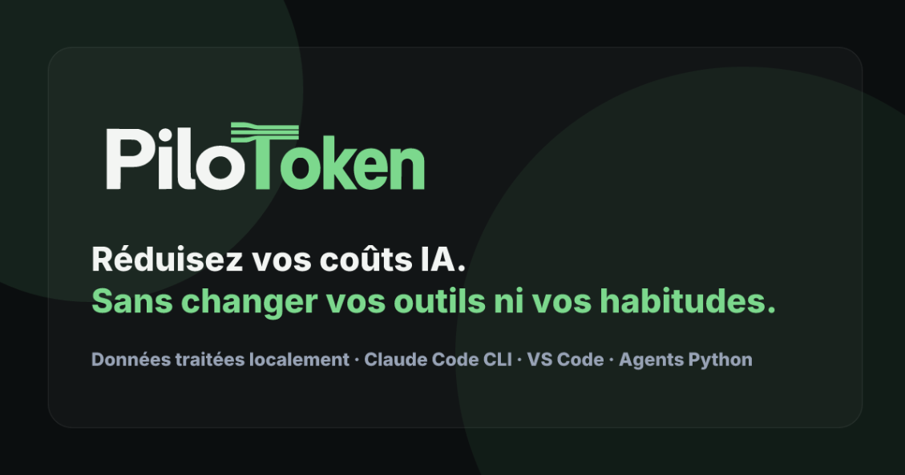
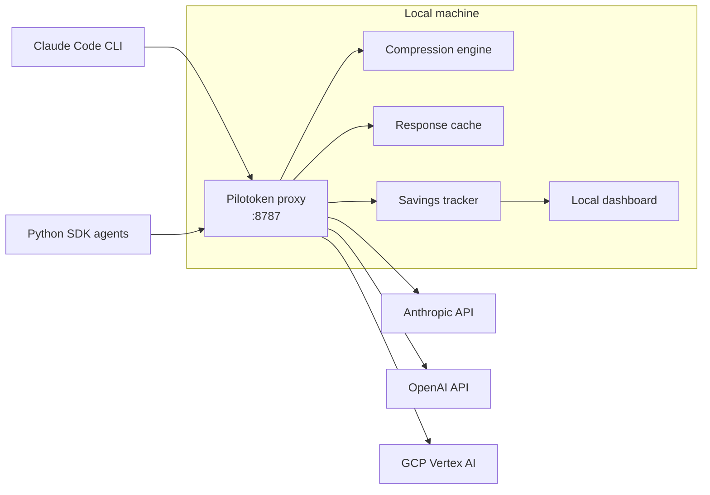
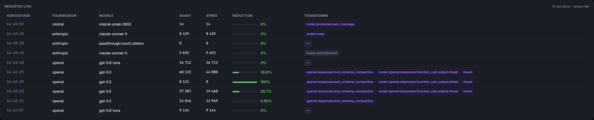
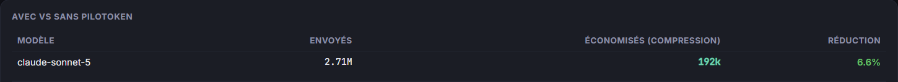
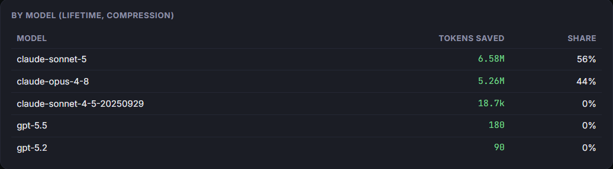

  

# Pilotoken — Local LLM Cost Proxy

> Cut LLM API costs for developer tools and AI agents — locally, with no code change.

**Personal project** · Showcase repository (no source code)

---

## The problem

Teams running Claude Code or Python agent pipelines send a lot of redundant tokens: repeated context, long tool outputs, re-sent files. Cloud-based optimizers fix part of this, but they require routing your prompts and code through a third-party server.

## The approach

Pilotoken is a **local proxy** that sits between your AI tools and the LLM provider. It compresses and caches requests **on your machine**, then forwards them to the provider you already use.

- **No code change**: tools and agents are redirected with one environment variable (`ANTHROPIC_BASE_URL`).
- **100% local**: prompts and code never leave the machine. Only license validation and price-table updates use a brief, explicit connection.
- **Pass-through**: same provider, same models, same authentication.

## Architecture

Each request goes through a router that decides what can be transformed safely: user messages are protected, some tools are excluded, and large tool outputs and tool schemas are compacted. Every transform applied is logged per request.

## Results (measured in real use)

| Workload | Metric | Value |
| --- | --- | --- |
| Interactive coding (Claude Code) | Compression, lifetime | 3.9–6.6% |
| Agent requests with large tool outputs | Compression, observed per request | 26.8–28.7% |
| All traffic | Cache hit rate | 96.8% |

Measured on my own usage. Compression gains depend heavily on workload: interactive coding sessions send little to compress, while agent requests carrying long tool outputs, logs and repeated context benefit most. The agent figures come from a small sample of individual requests.

### Live requests — per-request reduction and applied transforms

The OpenAI agent requests carrying large tool outputs show 26.8% and 28.7% reductions (tool-schema compaction + function-call output compression). Interactive Claude Code requests pass through mostly unchanged: user messages are protected by design.

### With vs. without Pilotoken (interactive coding)

### Tokens saved by compression, per model (local history)

### Expected range for automated agent workloads (not yet verified)

Automated agent pipelines send far more tool outputs, logs and retrieved documents than interactive coding sessions, which is where compression has the most to work on. The upstream engine's own published benchmarks report:

| Benchmark (Headroom) | Compression | Accuracy kept |
| --- | --- | --- |
| Tool calling (BFCL) | 32% | 97% |
| Question answering (SQuAD v2) | 19% | 97% |

On that basis, a **~20–30% input-token reduction** is a reasonable expectation for agent workloads, consistent with the 26.8–28.7% observed on individual agent requests above. It is **not yet measured on a full automated pipeline** — a sustained benchmark is the next step.

Cost figures shown in the dashboard are **estimates** based on public provider pricing, not guaranteed amounts.

## Features

- Transparent interception of Claude Code CLI (including Claude Pro authentication) and Python SDK agents
- Multi-provider routing: Anthropic, OpenAI, Mistral, Google Cloud Vertex AI
- Token compression with a per-request router (protected messages, excluded tools, tool-output and schema compaction)
- Response caching
- Local dashboard: overview, compression history (JSON/CSV export), live requests with applied transforms
- Team mode: shared team key and per-developer savings
- Windows installer (PyInstaller + installer packaging)
- Usage-based billing integration (Stripe, Supabase)

## Stack

Python (proxy) · TypeScript (dashboard and web app) · Supabase · Stripe · PyInstaller

## Scope and limitations

- Works with tools that call the API and accept a custom base URL. Browser chat interfaces (ChatGPT web, Claude.ai web) are not supported by design.
- Windows first. Docker / Linux support is on the roadmap.

## Credits

The compression engine builds on the open-source [Headroom](https://github.com/headroomlabs-ai/headroom) project (Apache 2.0).

---

**Author:** Steve Simon — Senior AI Engineer · [LinkedIn](https://www.linkedin.com/in/simon-steve)
